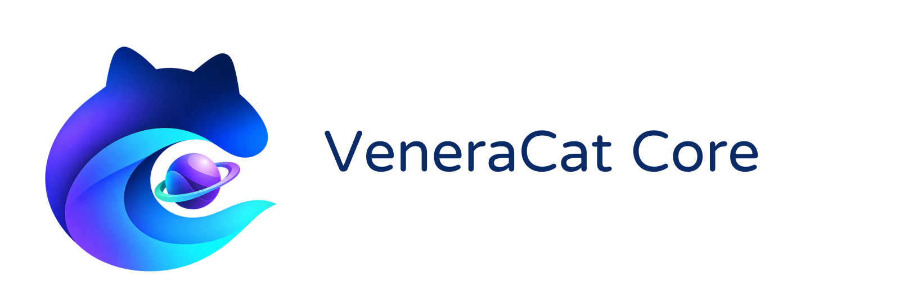

# VeneraCat Core

[English](README.en.md) | 简体中文

<picture>
  <source media="(prefers-color-scheme: dark)" srcset="docs/assets/brand/veneracat-core-logo-dark.png">
  
</picture>

Nekularity(iOS/iPadOS)与 Nekophage(桌面)共用的核心库,使用 Go 编写,许可证为 GPL-3.0-or-later。

## 功能

- **漫画源**:兼容官方 Venera 的 `ComicSource` JavaScript 脚本与订阅索引 `index.json`,在 [MoeJS](https://github.com/MoeForge/moejs) 上运行,每个源一个独立引擎。
- **视频源**:JavaScript `VideoSource` 插件、[Kazumi](https://github.com/Predidit/Kazumi) 规则、内置源,订阅格式为 `vcvideo.json`。
- **备份**:读取官方 `.venera` 备份,按项预览和恢复。
- **人机验证**:识别 Cloudflare 挑战,由客户端在 WebView 中完成后自动重试。
- **HLS**:播放列表解析、改写、去广告、AES-128 解密。

Core 不发起网络连接,也不打开 WebView 或播放器;这些由客户端通过 `host` 包中的接口提供。

## 目录

| 目录 | 内容 |
|---|---|
| `host/` | 客户端需要实现的接口 |
| `comic/` | 漫画源运行时与宿主接口 |
| `video/` | 视频数据模型、Kazumi、内置源、HLS |
| `plugin/` | 统一的插件注册表 |
| `subscription/` | 漫画与视频订阅索引 |
| `backup/` | 官方 `.venera` 备份 |
| `mobile/` | 供 Swift 调用的 gomobile 接口 |
| `version/` | 回答「这是哪一版 Core」,见下文 |
| `apple/` | Apple 平台冒烟测试 |
| `docs/` | 规格与设计文档 |
| `scripts/` | 构建与验证脚本 |

## 开发

```sh
gofmt -l .        # 应无输出
go vet ./...
go test -race ./...
```

Apple 平台的构建与验证见 `scripts/mac-verify.sh`,需要 macOS 与 Xcode。

## 这是哪一版 Core

`version.String()` 给出可打印的版本:Core 自己是主程序时用它自己的提交(工作树有改动会带 `-dirty`);被别的程序链接时,`debug.ReadBuildInfo()` 里那个提交属于**那个程序**,不能拿来冒充 Core —— 所以由链接方写一份戳记:

```go
import coreversion "github.com/laincat/veneracat-core/version"

func init() { coreversion.SetRelease("35b3ed9e…") }
```

桌面端就是这么做的:`scripts/fetch-core.sh` 每次生成一个 `corestamp.go` 写入同步到的提交号,`Nekophage -version` 因此能同时给出自身提交与 Core 提交。

文档索引见 [docs/README.md](docs/README.md)。
